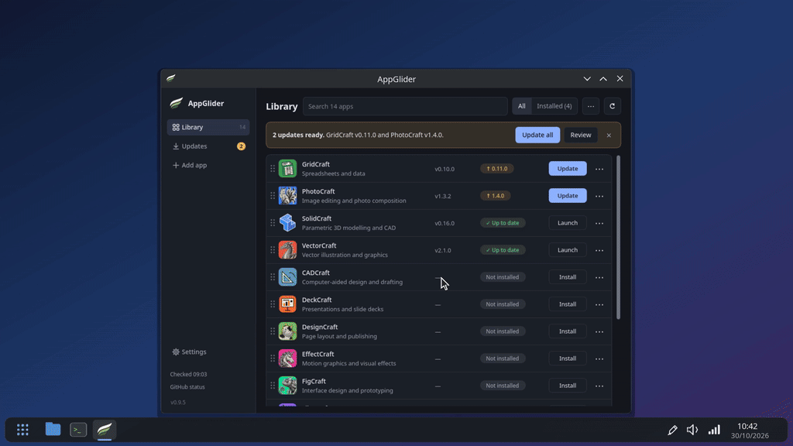
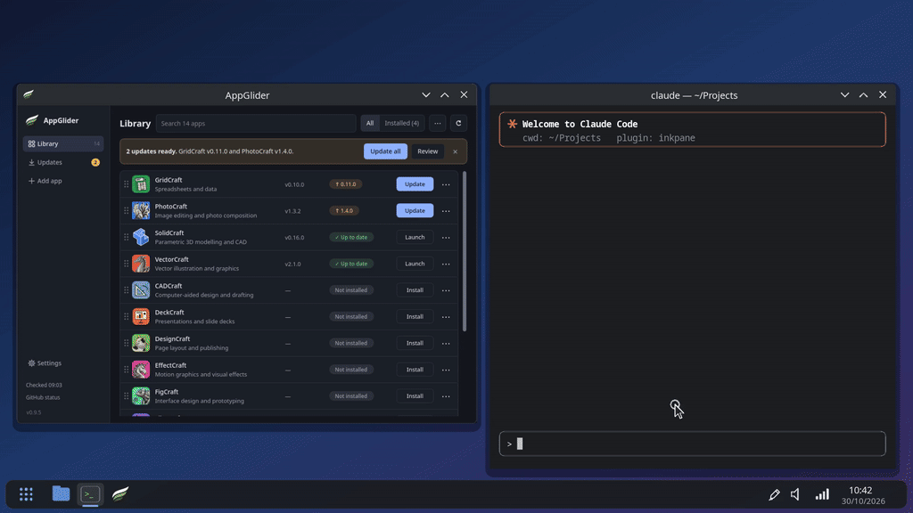

# Inkpane

**Draw on your screen** — for tutorials, presentations and screen recordings on Linux
Wayland desktops. Press a key, circle the button, add an arrow and a label, click
through to show it working, press the key again and it is gone.

<p align="center"></p>

## Why Inkpane

- **Small and fast.** A 285 KB program that waits in the tray at about 10 MB of memory
  and no CPU. Drawing is one cached mesh per monitor, anti-aliased, at full refresh rate.
- **The tools people actually use.** Pen, rectangle, diamond, ellipse, arrow, line,
  highlighter, text, numbered step markers and an eraser, with a whiteboard and
  blackboard. No selection, no layers, nothing to save: annotate, then it is gone.
- **Excalidraw's keys.** Tools on the number keys and letters (2 / R rectangle, 5 / A
  arrow, 7 / P pen …), Shift for squares and 15° angles, Ctrl from the centre.
- **Click-through.** Keep your drawing on screen while you click and type in the app
  below it, then carry on drawing: show a step, do it, show the next.
- **Screenshots with your notes on them.** Ctrl+S, drag an area (or click for the whole
  screen): saved to Pictures/Inkpane and copied to the clipboard, ready to paste.
- **An AI that points at your screen.** With the Claude Code plugin, Claude can circle
  the button to click, number the steps and sketch diagrams on a whiteboard, then take a
  screenshot to check how you got on. You do the clicking; it shows you where
  ([see it](#teach-with-claude-code)).
- **Recorder-friendly.** The drawing really is on screen, so OBS, Spectacle or any
  recorder captures it with no setup.

## Quick start

| Key | |
|---|---|
| **Meta+Z** | Start drawing · from click-through: back to drawing · while drawing: close and clear |
| 2–0 or R D O A L P T H E, N | Pick a tool (the toolbar shows them all) |
| Shift+1–8 | Colour |
| `[` `]` or wheel | Thinner / thicker |
| F | Fill rectangles, diamonds and ellipses |
| Shift / Ctrl while dragging | Square, snap to 15° / draw from the centre |
| Right drag | Erase |
| Ctrl+Z | Undo |
| Ctrl+Shift+Z or Ctrl+Y | Redo |
| C or Delete | Clear (Ctrl+Z brings it back) |
| 1 / V | Click-through: apps get the mouse and keys, your drawing stays |
| Ctrl+W / Ctrl+B | Whiteboard / blackboard |
| Ctrl+S | Screenshot: drag an area, or click for the whole screen |
| Tab | Hide or show the toolbar |
| F1 | Every key, on screen |
| Esc | Cancel the shape being drawn, or close and clear |

The [user guide](GUIDE.md) explains every tool, click-through, the boards, settings,
scripting and troubleshooting.

## Requirements

- A Wayland desktop with layer-shell: **KDE Plasma, Hyprland, Sway, niri, COSMIC**.
  GNOME and X11 sessions are not supported yet.
- SDL3 (3.2+), libwayland-client and GLib/GIO. No GTK, no Qt.
- Optional: **SDL3_ttf** for text, step markers, tooltips and the F1 help
  (`sdl3_ttf` on Arch). Everything else works without it.
- Screenshots need SDL 3.4 (or SDL3_image) and the desktop's screenshot portal;
  `wl-clipboard` makes copying them to the clipboard more reliable.

## Install

**Arch Linux:** build the package in [`packaging/aur`](packaging/aur/PKGBUILD) with
`makepkg -sir`. Pacman's `nim` is only needed to build, and `-r` removes it again
afterwards. If you use choosenim, your own Nim is not touched; to build with it
instead, run `makepkg -si --nodeps`.

**From source** (needs Nim 2.2+):

```bash
nimble install https://github.com/nim-lang/sdl3
nimble Release
scripts/install-user.sh        # or: scripts/install-user.sh --autostart
inkpane &
```

This installs `inkpane` and `inkpane-mcp` (for AI clients). Installing matters: the
desktop only grants the Meta+Z shortcut to apps with an installed `.desktop` file.
`scripts/uninstall-user.sh` removes everything again.

The first time you press Meta+Z, KDE asks you to confirm the shortcut. On compositors
without the shortcut portal, bind `inkpane --toggle` to a key yourself (see the
[guide](GUIDE.md#controlling-inkpane-from-scripts)).

## Teach with Claude Code

<p align="center"></p>

Inkpane comes with a Claude Code plugin: an MCP server (`inkpane-mcp`) and a skill
that teaches Claude to guide you step by step on your real screen. Install Inkpane
first, then in Claude Code:

```
/plugin marketplace add Vyrnexis/Inkpane
/plugin install inkpane@inkpane
```

Then ask things like *"How do I turn on night colour in KDE? Show me on my screen"* or
*"Explain how git branches work, on the whiteboard"*. Claude asks before its first
screenshot, marks one step at a time, and waits for you to do it. It can only draw:
every click is yours. Other MCP clients can use `inkpane-mcp` directly
(`claude mcp add inkpane -- inkpane-mcp` adds just the server). See the
[guide](GUIDE.md#ai-claude-points-at-your-screen).

## Size and speed

Measured on a release build (x86-64, KDE Plasma):

| | |
|---|---|
| Binary | 285 KB; links only SDL3, libwayland-client and libc (`inkpane-mcp`: 160 KB, no SDL) |
| Idle in the background | ~10 MB resident (~1.5 MB of it Inkpane's own), 0 % CPU |
| Drawing | ~8 µs per pen point; one draw call per monitor per frame |
| Undo or erase on a busy screen | under 4 ms to rebuild 30 000 points |

Lines and shapes are triangles with a one-pixel fading edge for anti-aliasing, so no
screen-sized multisample buffers are needed. Toolbar icons are drawn the same way: no
icon files, no icon font. GLib is opened at start and SDL3_ttf only when text is first
used.

## License

MIT. The Wayland protocol XML files in `src/inkpane/wayland/protocols/` keep their own
licences.
